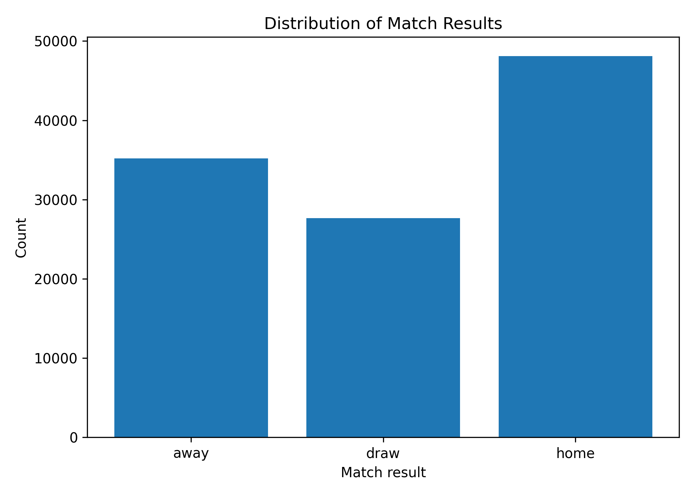
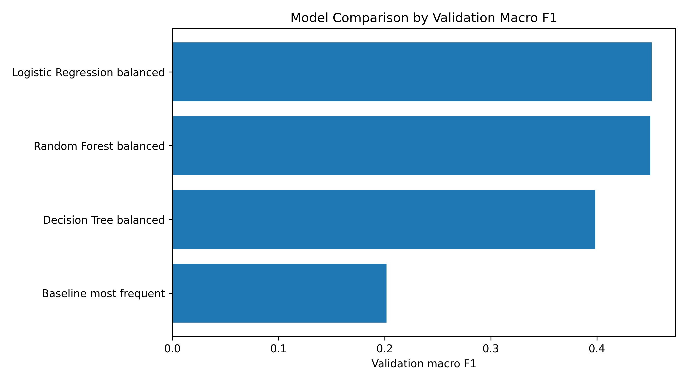
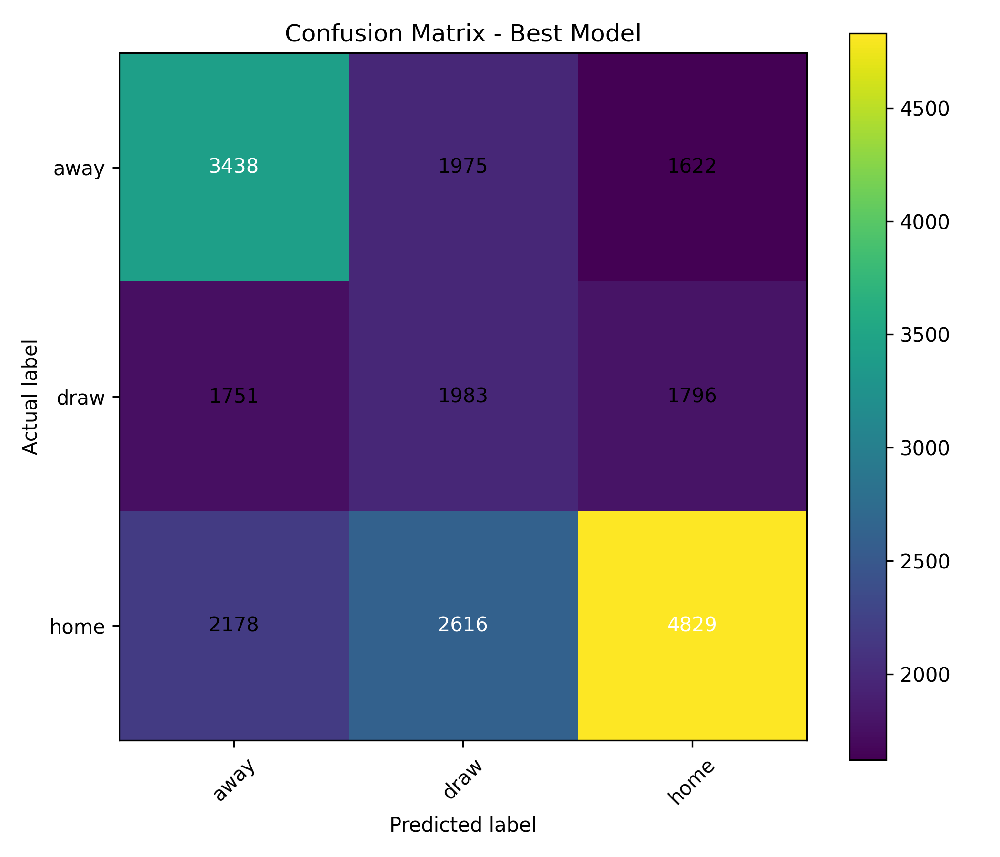
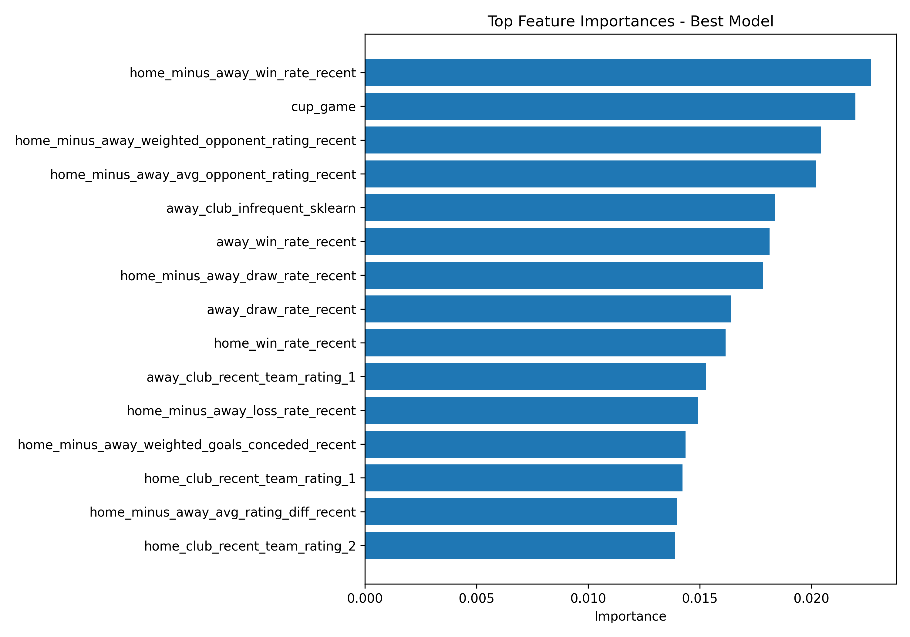

# Football Match Outcome Prediction

An end-to-end multiclass classification pipeline for predicting football match outcomes (`home`, `away`, `draw`) from historical fixture records and recent club performance statistics. Built as a Data Mining course project at K. N. Toosi University of Technology (Spring 2026).

## Overview

The pipeline processes **110,938** historical football matches (190 raw columns) containing fixture metadata, club/manager identifiers, and statistics from each club's previous ten matches. Because the target classes are imbalanced—**home** (43.37%), **away** (31.71%), and **draw** (24.92%)—models were trained with class balancing and selected using **Validation Macro F1**.

### Key Highlights
- **Feature Engineering:** Expanded the dataset to **244 features** before encoding by extracting temporal attributes (`fixture_year`, `fixture_month`, `fixture_dayofweek`, `fixture_is_weekend`, `fixture_season_start_year`, `days_since_last_match`), computing both standard and recency-weighted rolling statistics (goals scored/conceded, goal difference, points, win/draw/loss rates, team and opponent ratings), and creating direct `home_minus_away` differential features.
- **Leak-Free Preprocessing:** Handled **1,778,875** missing feature values strictly inside a Scikit-learn `ColumnTransformer` / `Pipeline` (median imputation + scaling for numerical features; most-frequent imputation + `OneHotEncoder(min_frequency=20)` for high-cardinality categorical features).
- **Stratified Evaluation:** Evaluated models on a stratified **70% / 10% / 20%** split (77,656 train / 11,094 validation / 22,188 test).

## Model Comparison

Models were selected by **Validation Macro F1** and evaluated on the held-out test set:

| Model | Val Accuracy | Val Macro F1 | Test Accuracy | Test Macro F1 | Test Log Loss |
| :--- | :---: | :---: | :---: | :---: | :---: |
| **Logistic Regression (Balanced)** | 0.465 | **0.452** | 0.462 | **0.449** | 1.036 |
| Random Forest (Balanced) | **0.479** | 0.450 | **0.472** | 0.444 | **1.030** |
| Decision Tree (Balanced) | 0.405 | 0.398 | 0.413 | 0.406 | 1.438 |
| Baseline (Most Frequent) | 0.434 | 0.202 | 0.434 | 0.202 | 20.411 |

### Class-Wise Test Performance (Selected Model: Balanced Logistic Regression)

| Class | Precision | Recall | F1-Score | Support |
| :--- | :---: | :---: | :---: | :---: |
| `home` | 0.59 | 0.50 | 0.54 | 9,623 |
| `away` | 0.47 | 0.49 | 0.48 | 7,035 |
| `draw` | 0.30 | 0.36 | 0.33 | 5,530 |

## Key Insights & Visualizations

Feature importance analysis highlights that recent form differentials (`home_minus_away_win_rate_recent`), match context (`cup_game`), and relative opponent strength (`home_minus_away_weighted_opponent_rating_recent`) are the strongest predictors. As expected in football analytics, predicting draws remains the most challenging class.

| Target Distribution | Model Comparison (Macro F1) |
| :---: | :---: |
|  |  |

| Confusion Matrix (Best Model) | Top Feature Importances |
| :---: | :---: |
|  |  |

## Usage

### 1. Install Dependencies
```bash
pip install -r requirements.txt
```

### 2. Run the Pipeline
> **Note:** The raw CSV dataset is excluded from this repository due to its large file size.

```bash
python football_match_prediction_project.py --csv path/to/dataset.csv --output outputs
```

## Future Improvements
- Replace stratified random splitting with a **chronological (time-based) split** to better mirror real-world forecasting across seasons.
- Benchmark gradient-boosted decision trees (e.g., LightGBM / XGBoost) and probability calibration techniques to further reduce log loss.

## Authors
- **Adel Nourbakhsh**
- **Mohammadreza Ahmadi**
- **Armita Kangavarchi**